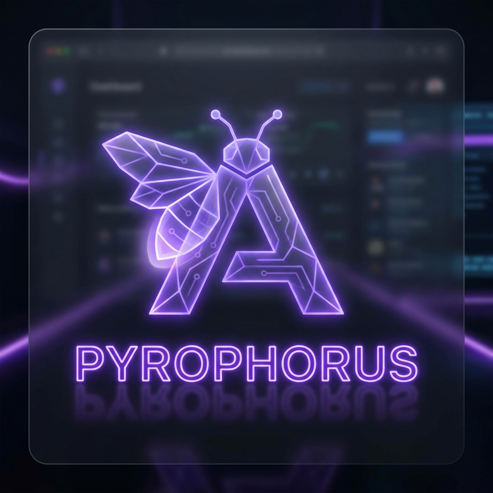
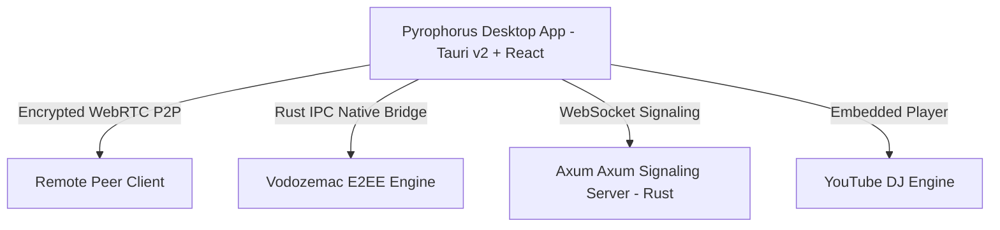

# 🔥 Pyrophorus

<p align="center">
  
</p>

<h3 align="center">Next-Generation End-to-End Encrypted Desktop Communication & Voice Lounge</h3>

<p align="center">
  
  
  
  
</p>

---

## ⚡ OverView

**Pyrophorus** is a high-performance, privacy-focused desktop communications platform engineered for power users and modern communities. Built with **Rust**, **Axum**, **Tauri v2**, and **React**, Pyrophorus combines military-grade encryption with a stunning 16:9 Discord-style stage lounge experience.

---

## ✨ Key Features

- 🔒 **End-to-End Encryption (E2EE)**: Powered by Matrix `vodozemac` Olm cryptographic ratchet engine for uncompromised privacy.
- 🎙️ **16:9 Aspect Ratio Voice Lounge**: Widescreen tile ratio preservation matching Discord desktop standards.
- 📜 **5+ Participant Auto-Scroll Grid**: Smart vertical auto-scrolling stage grid for large rooms (5+ users).
- 🎵 **Integrated YouTube Music DJ Bot**: Synchronized music playback queue, seek controls, requester permission locking, and per-user volume controls.
- 📺 **Ultra HD 4K Screen Sharing**: Up to 4K 60FPS Windows Graphics Capture stream with crisp text detail hints.
- 🎨 **Rich Glassmorphism UI**: High-end dark theme UI, real-time voice activity indicators, glowing green speaking rings, and context volume menus.
- ⚡ **Lightweight Footprint**: Extremely low RAM & CPU consumption powered by Rust Tauri Native IPC.

---

## 📦 Downloads & Installers

Official Windows distribution packages are located in the release bundles:

| Package | Format | File Path |
| :--- | :--- | :--- |
| **Pyrophorus Setup** | `.exe` (NSIS Installer) | `client/src-tauri/target/release/bundle/nsis/Pyrophorus_0.1.0_x64-setup.exe` |
| **Pyrophorus MSI** | `.msi` (MSI Package) | `client/src-tauri/target/release/bundle/msi/Pyrophorus_0.1.0_x64_en-US.msi` |
| **Portable Exe** | `.exe` (Standalone App) | `client/src-tauri/target/release/pyrophorus.exe` |

---

## 🛠️ Architecture & Tech Stack



### Stack Components:
- **Client**: Tauri v2, React 18, TypeScript, TailwindCSS, Lucide Icons, WebRTC Native API
- **Cryptography**: `vodozemac` (Matrix Olm Rust Crate), SHA-256 Fingerprinting
- **Backend Server**: Axum, Tokio Async Runtime, WebSockets

---

## 🚀 Building & Running Locally

### Prerequisites
- [Node.js](https://nodejs.org/) v18+
- [Rust Toolchain](https://www.rust-lang.org/)

### 1. Start Backend & Client
Run the unified start script from root:
```cmd
BAŞLAT.bat
```

### 2. Manual Dev Launch
```bash
# Terminal 1: Start Backend Server
cd server
cargo run

# Terminal 2: Start Tauri Desktop Client
cd client
npm run dev
```

### 3. Production Release Build
```bash
cd client
npm run tauri build
```

---

<p align="center">
  Developed with ❤️ for secure, ultra-fast, and beautiful desktop communications.
</p>
