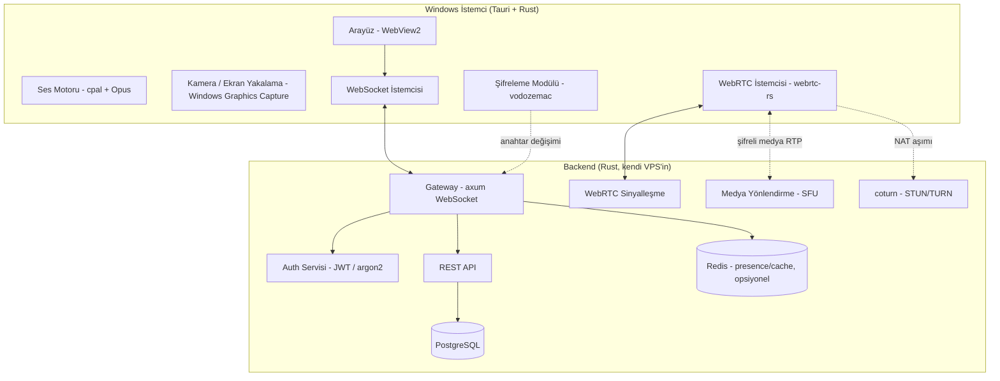

# Discord Benzeri Masaüstü İletişim Uygulaması — Yol Haritası

> Windows için, arkadaş grubu ölçeğinde (10-50 kullanıcı), sunucu/kanal yapılı, uçtan uca şifreli, sesli/görüntülü/ekran paylaşımlı iletişim uygulaması.

## 1. Proje Özeti ve Hedefler

| Gereksinim | Karşılık |
|---|---|
| Düşük sistem kaynağı | Tauri (Electron değil) + native Windows API'leri |
| Hızlı/gecikmesiz mesajlaşma | WebSocket + ikili (binary) protokol |
| Tam uçtan uca şifreli haberleşme | vodozemac (metin) + WebRTC DTLS-SRTP (medya) |
| Sesli/görüntülü görüşme | WebRTC (webrtc-rs / rtc) |
| Ekran paylaşımı + çoklu monitör seçimi | Windows Graphics Capture API |
| Discord benzeri sunucu/kanal | Guild-channel-role veri modeli |
| Native kurulum deneyimi | Tauri NSIS/MSI installer, Başlat Menüsü + masaüstü kısayolu |
| GitHub üzerinden dağıtım | GitHub Actions CI/CD + GitHub Releases + otomatik güncelleme |
| Kendi backend sunucusu | Rust (axum) + PostgreSQL, kendi VPS'inde |
| Dil tercihi | Ağırlıklı Rust, gerektiğinde (düşük seviye Windows entegrasyonu) C++ |

**Gerçekçi beklenti:** Bu, Discord'un küçültülmüş bir klonu — tek başına yapılsa bile birkaç aylık bir hobi projesi. Aşağıdaki yol haritası bunu **MVP → genişletme** mantığıyla parçalara ayırıyor, böylece 2-3 hafta içinde arkadaşlarınla metin+ses konuşabildiğin çalışan bir şey olur, gerisi üzerine eklenir.

---

## 2. Mimari Genel Bakış



**Bileşenlerin rolü:**
- **Gateway (axum + WebSocket):** Anlık mesaj, sunucu/kanal olayları, presence (kim çevrimiçi) — Discord'daki "gateway" ile aynı görevi görür.
- **Signaling:** WebRTC bağlantı kurulumu için SDP/ICE bilgisini istemciler arasında taşır; medyanın kendisine dokunmaz.
- **SFU (Selective Forwarding Unit):** Sesli/görüntülü/ekran akışlarını katılımcılar arasında **şifreyi çözmeden** yönlendirir — böylece hem çoklu kullanıcı görüşmesi ölçeklenir hem de sunucu medya içeriğini göremez.
- **TURN (coturn):** Arkadaşlarının bazıları CGNAT/simetrik NAT arkasındaysa doğrudan P2P bağlantı kurulamaz; TURN sunucusu trafiği röle eder. Kendi VPS'ine coturn kurman gerekecek (bu tek başına Rust değil ama hazır ve endüstri standardı).

---

## 3. Teknoloji Yığını ve Gerekçeler

| Katman | Seçim | Neden |
|---|---|---|
| İstemci arayüz çatısı | **Tauri v2** (Rust çekirdek + sistemin WebView2'si) | Electron'a göre çok daha küçük binary ve çok daha düşük RAM/disk kullanımı; Windows'ta zaten yüklü olan WebView2'yi kullanır. Stabil, olgun (v2.10+), NSIS/MSI installer üretimini kutudan çıkar çıkmaz destekler. |
| Ses I/O | **cpal** | Rust'ta düşük seviye, düşük gecikmeli ses giriş/çıkışı |
| Ses codec | **Opus** | Düşük gecikme + düşük bant genişliği, ses görüşmeleri için endüstri standardı |
| Kamera/ekran yakalama | **windows-rs** ile Windows Graphics Capture API | Donanım hızlandırmalı, düşük CPU kullanımı, çoklu monitör + pencere seçimini native destekler |
| WebRTC | **webrtc-rs** (async, olgun) veya yeni **rtc** (sans-I/O, daha esnek/kontrol edilebilir) | İkisi de aktif geliştiriliyor. Başlangıç için `webrtc-rs` (daha çok örnek/dokümantasyon), performans ayarı gerekince `rtc`'ye geçiş kapıda kalsın. |
| Backend HTTP/WS | **axum** (Tokio üzerinde) | Async, yüksek performans, geniş ekosistem |
| Veritabanı | **PostgreSQL** + `sqlx` | İlişkisel, async destekli, güvenilir |
| Cache/Presence | **Redis** (opsiyonel, başta atlanabilir) | Çevrimiçi durumu, hız sınırlama sayaçları |
| Metin E2EE | **vodozemac** (Matrix'in Olm/Megolm — Signal protokolüne çok benzer Double Ratchet) | Saf Rust, bağımsız denetimden geçmiş, üretimde (Matrix/Element) kanıtlanmış |
| Medya şifreleme | WebRTC'nin yerleşik **DTLS-SRTP**'si | SFU medyayı çözmeden yönlendirebildiği için uçtan uca korunur |
| Kimlik doğrulama | JWT (kısa ömürlü access + refresh token) + **argon2id** şifre hash | Güncel, önerilen standart |
| Installer | Tauri bundler → NSIS (`-setup.exe`) veya MSI | Başlat Menüsü kaydı, masaüstü kısayolu, kaldırma otomatik gelir |
| Otomatik güncelleme | `tauri-plugin-updater` + GitHub Releases | Yeni sürüm GitHub'a push'landığında istemciler otomatik güncellenir |
| CI/CD | GitHub Actions (Windows runner) | Push'ta otomatik derleme + Release'e installer yükleme |
| STUN/TURN | **coturn** | NAT arkasındaki kullanıcılar için zorunlu, endüstri standardı |

---

## 4. Kritik Mimari Kararlar (baştan netleştirilmeli)

1. **Mesh mi SFU mi?** 2-3 kişilik sesli sohbetlerde P2P mesh (herkes herkese doğrudan bağlanır) yeterli ve daha basittir. 4+ kişi + ekran paylaşımı olduğunda mesh'in yük ve bant genişliği kullanıcı başına katlanarak artar — SFU şart olur. **Öneri:** MVP'de mesh ile başla, Faz 5'te SFU'ya geç.
2. **webrtc-rs vs libwebrtc (C++):** `webrtc-rs`/`rtc` saf Rust ve hedefine uygun ama genç bir proje; Google'ın `libwebrtc`'si çok daha olgun/optimize ama C++ ve entegrasyonu ağır. Rust önceliğin olduğu için `webrtc-rs` ile başlaman mantıklı; ciddi performans sorunu çıkarsa C++ tarafına (bu senin de kabul ettiğin "gereken yerde C++" durumu) geçiş kapısı bırak.
3. **Tam E2EE'nin bedeli:** Sunucu mesaj içeriğini hiç görmeyecekse, sunucu tarafında mesaj arama, moderasyon, bildirim önizlemesi gibi Discord'da alışık olduğun bazı özellikler zorlaşır ya da imkansızlaşır (istemci tarafında yapılmaları gerekir). Küçük bir arkadaş grubunda bu genelde sorun değil, ama bilerek karar vermek lazım.
4. **Self-hosted TURN zorunluluğu:** "Gecikmesiz" istiyorsan ve arkadaşların farklı ISS'lerdeyse, en azından bir TURN sunucusuna ihtiyacın olacak — P2P her zaman kurulamaz.

---

## 5. Yol Haritası (Fazlar)

Süreler, hobi projesi / part-time çalışma varsayımıyla kabaca verilmiştir.

### Faz 0 — Planlama (3-5 gün)
Teknoloji seçimlerinin kesinleştirilmesi, veritabanı şeması taslağı, protokol (mesaj formatı, olay tipleri) tasarımı, VPS'in hazırlanması (Linux, Docker, domain, TLS sertifikası).

### Faz 1 — Backend İskeleti + Auth (1-2 hafta)
Kullanıcı kayıt/giriş, JWT auth, PostgreSQL şeması, temel REST API.

### Faz 2 — İstemci İskeleti (1 hafta)
Tauri projesi, giriş ekranı, sistem tepsisi, kurulum paketi (installer) pipeline'ının en baştan çalışır hale getirilmesi.

### Faz 3 — Metin Mesajlaşma + Sunucu/Kanal Yapısı (2-3 hafta)
WebSocket gateway, sunucu/kanal/rol CRUD işlemleri, gerçek zamanlı mesaj iletimi, mesaj geçmişi, metin E2EE entegrasyonu (vodozemac).

**→ Bu noktada arkadaşlarınla yazışabilen bir MVP'niz var.**

### Faz 4 — Sesli Görüşme (2-3 hafta)
WebRTC signaling, mesh P2P sesli görüşme, Opus entegrasyonu, mikrofon seçimi/ses seviyesi göstergesi, gecikme/jitter ölçümü.

### Faz 5 — SFU'ya Geçiş + Görüntülü Görüşme + Ekran Paylaşımı (3-5 hafta — projenin en zor kısmı)
Sunucu tarafı SFU, kamera akışı, ekran yakalama (Windows Graphics Capture), çoklu monitör/pencere seçim arayüzü, video codec ayarları.

### Faz 6 — Güvenlik Sertleştirme (1-2 hafta)
E2EE anahtar değişimi denetimi, rate limiting, VPS güvenlik sertleştirme (firewall, fail2ban, TLS yenileme), bağımlılık taraması (`cargo audit`).

### Faz 7 — Performans Optimizasyonu (sürekli, ama ayrılmış 1 hafta odaklı çalışma)
Bellek/CPU profiling, ses/görüntü gecikme ölçümü ve iyileştirme, yeniden bağlanma senaryoları (Wi-Fi kopması, uyku modundan çıkış vb.).

### Faz 8 — Dağıtım Otomasyonu (3-5 gün)
GitHub Actions ile otomatik build + Release, `tauri-plugin-updater` ile otomatik güncelleme, (opsiyonel ama önerilir) kod imzalama sertifikası — imzasız `.exe` Windows SmartScreen'de "bilinmeyen yayıncı" uyarısı verir, arkadaş grubu için sorun değilse atlanabilir.

### Faz 9 — Beta Test (sürekli)
Arkadaş grubunla gerçek kullanım, hata ayıklama, UI/UX iyileştirme.

---

## 6. Detaylı Görev Listesi

### Faz 0 — Planlama
- [ ] Teknoloji yığınını netleştir (bu dokümandaki önerileri onayla/değiştir)
- [ ] VPS kirala, Docker + Docker Compose kur
- [ ] Domain al, Let's Encrypt ile TLS sertifikası kur (Caddy veya nginx reverse proxy önerilir)
- [ ] PostgreSQL şemasının ilk taslağını çiz (bkz. Bölüm 7)
- [ ] WebSocket mesaj/olay formatını tasarla (JSON mı, binary (bincode/protobuf) mı?)

### Faz 1 — Backend + Auth
- [ ] `axum` ile minimal Rust projesi, `/health` endpoint'i
- [ ] PostgreSQL bağlantısı (`sqlx`), migration sistemi (`sqlx-cli`)
- [ ] Kullanıcı kayıt endpoint'i (argon2id hash)
- [ ] Giriş endpoint'i (JWT access + refresh token)
- [ ] Token doğrulama middleware'i
- [ ] Temel rate limiting (`tower-governor`)

### Faz 2 — İstemci İskeleti
- [ ] `tauri create` ile proje kurulumu (React/Svelte/Vue frontend — tercihine göre)
- [ ] Giriş/kayıt ekranı, backend'e bağlanma
- [ ] Sistem tepsisi (tray) entegrasyonu, kapatma yerine tepsiye küçültme
- [ ] `tauri build` ile NSIS installer üretimini doğrula (Başlat Menüsü kaydı otomatik gelir)
- [ ] GitHub reposu kurulumu, ilk commit

### Faz 3 — Mesajlaşma + Sunucu/Kanal
- [ ] WebSocket gateway (bağlantı, kimlik doğrulama handshake'i)
- [ ] Sunucu (guild) oluşturma/silme/davet linki
- [ ] Kanal oluşturma (metin/ses tipi)
- [ ] Rol ve izin sistemi (bitfield tabanlı, Discord'a benzer)
- [ ] Gerçek zamanlı mesaj gönder/al
- [ ] Mesaj geçmişi (sayfalama ile REST endpoint)
- [ ] `vodozemac` ile cihaz anahtarı üretimi ve anahtar değişimi (X3DH benzeri)
- [ ] Mesajların istemci tarafında şifrelenip sunucuya şifreli gitmesi

### Faz 4 — Sesli Görüşme
- [ ] `webrtc-rs` ile signaling protokolü (offer/answer/ICE candidate WebSocket üzerinden)
- [ ] Mesh P2P bağlantı kurulumu (2-4 kişi)
- [ ] `cpal` ile mikrofon yakalama, Opus encode
- [ ] Ses seviyesi göstergesi, mikrofon/hoparlör seçimi ayarları
- [ ] Kendi coturn (STUN/TURN) sunucunu kur ve bağla

### Faz 5 — SFU + Video + Ekran Paylaşımı
- [ ] Sunucu tarafı SFU implementasyonu (gelen RTP'yi çözmeden diğer katılımcılara yönlendirme)
- [ ] Kamera yakalama ve video track ekleme
- [ ] Windows Graphics Capture API ile ekran yakalama
- [ ] Çoklu monitör tespiti + kullanıcıya "hangi ekranı paylaşmak istiyorsun" seçim arayüzü
- [ ] Belirli bir pencereyi paylaşma seçeneği (opsiyonel, güzel bir ekleme)
- [ ] Video codec/bitrate ayarları (bant genişliğine göre otomatik ayarlama)

### Faz 6 — Güvenlik
- [ ] E2EE anahtar doğrulama akışı (parmak izi karşılaştırma / SAS)
- [ ] `cargo audit` / `cargo deny` CI adımı olarak ekle
- [ ] Firewall kuralları (yalnızca gerekli portlar açık)
- [ ] fail2ban veya benzeri brute-force koruması
- [ ] Sunucu loglarının hassas veri (şifre, mesaj içeriği) içermediğini doğrula

### Faz 7 — Performans
- [ ] İstemci bellek/CPU profiling (özellikle boşta dururken ne kadar RAM tüketiyor?)
- [ ] Ses/görüntü gecikmesini ölç (uçtan uca hedef: <150ms)
- [ ] Ağ kopması sonrası otomatik yeniden bağlanma
- [ ] Zayıf bağlantıda otomatik kalite düşürme (adaptif bitrate)

### Faz 8 — Dağıtım
- [ ] GitHub Actions workflow: push → Windows runner'da `tauri build` → artifact
- [ ] GitHub Releases'e otomatik installer yükleme
- [ ] `tauri-plugin-updater` yapılandırması + update manifest'i
- [ ] (Opsiyonel) Kod imzalama sertifikası edinme ve entegre etme

### Faz 9 — Beta
- [ ] Arkadaş grubuna dağıt, gerçek kullanım testi
- [ ] Hata/çökme raporlama mekanizması (basit bir log yükleme endpoint'i yeterli)
- [ ] Geri bildirimlere göre önceliklendirme ve iyileştirme

---

## 7. Veritabanı Şeması Taslağı (özet)

```
users            (id, username, email, password_hash, public_identity_key, created_at)
devices          (id, user_id, device_name, olm_identity_key, one_time_keys, last_seen)
servers          (id, name, owner_id, icon_url, created_at)          -- "guild"
server_members   (server_id, user_id, nickname, joined_at)
roles            (id, server_id, name, permissions_bitmask, color, position)
member_roles     (server_id, user_id, role_id)
channels         (id, server_id, name, type[text|voice], position)
messages         (id, channel_id, sender_id, ciphertext, nonce, created_at, edited_at)
dm_sessions      (id, user_a_id, user_b_id, olm_session_state)
voice_presence   (channel_id, user_id, joined_at)                    -- kim şu an sesli kanalda
attachments      (id, message_id, encrypted_blob_ref, mime_type, size)
```

---

## 8. Güvenlik Kontrol Listesi

- [ ] Tüm bağlantılar TLS üzerinden (WSS, HTTPS) — düz metin WS/HTTP yok
- [ ] Şifreler argon2id ile hashlenir, asla düz metin/geri döndürülebilir formda saklanmaz
- [ ] Access token kısa ömürlü (örn. 15 dk), refresh token rotasyonlu
- [ ] Sunucu, mesaj içeriğini yalnızca şifreli blob olarak görür/saklar
- [ ] Medya (ses/video/ekran) SFU üzerinden şifresi çözülmeden yönlendirilir
- [ ] Rate limiting: giriş denemeleri, mesaj gönderimi, davet linki oluşturma
- [ ] `cargo audit` CI pipeline'ında zorunlu adım
- [ ] VPS: sadece gerekli portlar açık, SSH key-only giriş, düzenli güncelleme

---

## 9. AI Kodlama Asistanı için Başlangıç Promptu

Aşağıdaki metni bir AI kodlama asistanına (Claude Code gibi) projenin başında context olarak verebilirsin. Faz ilerledikçe "BAŞLANGIÇ GÖREVİ" kısmını güncelle.

```
Sen kıdemli bir Rust ve sistem programlama uzmanısın. Aşağıdaki projeyi benimle
adım adım, faz faz geliştireceksin.

PROJE: Windows için, arkadaş grubu ölçeğinde (10-50 kullanıcı) çalışacak,
Discord benzeri bir sesli/görüntülü/metin iletişim uygulaması.

MİMARİ:
- İstemci: Tauri v2 (Rust çekirdek + web frontend), Windows'a normal bir
  masaüstü uygulaması gibi kurulacak (Başlat Menüsü + masaüstü kısayolu,
  sistem tepsisi desteği)
- Backend: Rust (axum), kendi VPS'imde (Linux) çalışacak
- Veritabanı: PostgreSQL (sqlx)
- Gerçek zamanlı mesajlaşma: WebSocket gateway
- Sesli/görüntülü görüşme + ekran paylaşımı: WebRTC (webrtc-rs), küçük
  gruplarda mesh, 4+ kişide sunucu tarafı SFU
- Metin şifrelemesi: vodozemac (Olm/Megolm, Signal protokolüne benzer
  Double Ratchet) ile uçtan uca şifreleme — sunucu mesaj içeriğini asla
  düz metin görmemeli
- Medya şifrelemesi: WebRTC'nin yerleşik DTLS-SRTP'si

TEMEL GEREKSİNİMLER (öncelik sırasıyla):
1. Düşük sistem kaynağı kullanımı — Electron KULLANMA, Tauri kullan
2. Gecikmesiz, gerçek zamanlı metin mesajlaşma
3. Tam uçtan uca şifreli haberleşme
4. Sesli ve görüntülü görüşme, düşük gecikme öncelikli
5. Ekran paylaşımı — kullanıcı birden fazla monitöre sahipse hangi ekranı
   paylaşacağını seçebilmeli
6. Discord benzeri "sunucu" (guild) / "kanal" / rol yapısı
7. Kurulum sonrası normal bir Windows uygulaması gibi davranmalı
8. GitHub Releases üzerinden dağıtım + otomatik güncelleme
9. Mümkün olduğunca Rust; sadece gerçekten gerekiyorsa (çok düşük seviye
   Windows API entegrasyonu gibi) C++ kullan, ve neden gerektiğini açıkla

KODLAMA KURALLARI:
- clippy uyarısı bırakma
- unwrap()/panic! yerine thiserror + anyhow ile proper error handling
- Async kod için tokio
- Her yeni modül için birim testi yaz
- Şifreleme/auth ile ilgili kodda ekstra dikkatli ol, seçtiğin yöntemi ve
  neden güvenli olduğunu kısaca açıkla
- Büyük mimari kararlarda (örn. mesh'ten SFU'ya geçiş zamanı) bana sor,
  varsayım yapıp sessizce ilerleme

ÇALIŞMA ŞEKLİ:
Her adımda: (1) ne yapacağını kısaca açıkla, (2) kodu yaz, (3) nasıl test
edileceğini söyle. Şu an [FAZ NUMARASINI VE ADINI BURAYA YAZ] üzerinde
çalışıyoruz.

BAŞLANGIÇ GÖREVİ:
Backend projesinin iskeletini oluştur: axum tabanlı, /health endpoint'i
olan, PostgreSQL'e sqlx ile bağlanan minimal bir Rust projesi kur. Docker
Compose ile yerel geliştirme için Postgres konteynerini de ekle.
```

---

## 10. Referans Açık Kaynak Projeler (öğrenmek için)

- **Revolt.chat** — Rust ile yazılmış, açık kaynak Discord alternatifi; gerçek bir sunucu/kanal/rol veri modelini incelemek için iyi bir referans.
- **Matrix / Element** — Uçtan uca şifreleme (Olm/Megolm, yani vodozemac'ın kaynağı) mimarisini anlamak için.
- **LiveKit** — Açık kaynak SFU mimarisi; kendi SFU'nu yazarken tasarım kararlarını incelemek faydalı olur (Go ile yazılmış ama kavramlar aynı).
- **coturn** — STUN/TURN sunucusu, kendi barındıracağın parça.

---

## 11. Önerilen İlk Adım

Faz 0 ve Faz 1'e başlamadan önce netleştirilmesi gerekenler: VPS sağlayıcın, domain adın ve frontend için React/Svelte tercihin. Bunlar netleşince Faz 1'in ilk görevini (backend iskeleti) doğrudan yukarıdaki AI promptuyla bir kodlama asistanına verip başlayabilirsin.
